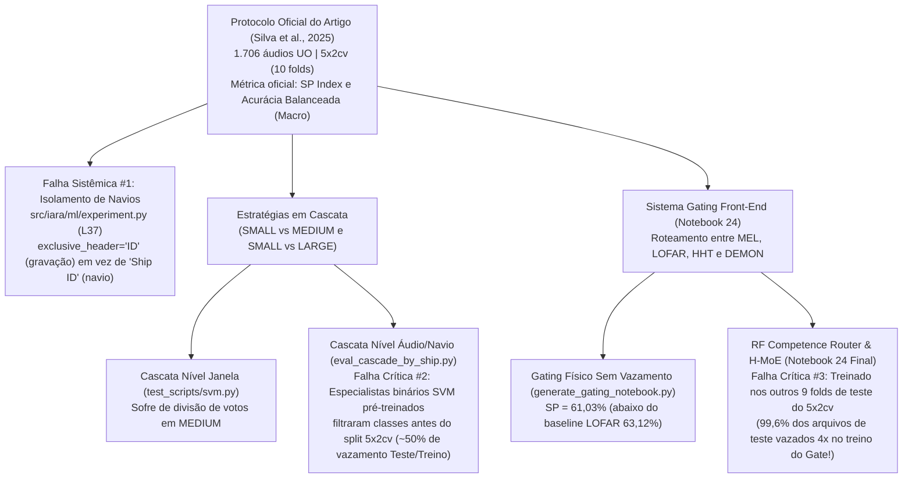

# Relatório de Auditoria Científica e de Código — Projeto IARA

Este documento consolida a verificação cruzada entre o artigo de referência (*Silva et al., IEEE Access 2025*, em [IARA_An_Underwater_Acoustic_Database.pdf](file:///c:/Users/ev_ro/git/IARA/artigo/IARA_An_Underwater_Acoustic_Database.pdf) e [IARA_An_Underwater_Acoustic_Database.md](file:///c:/Users/ev_ro/git/IARA/artigo/IARA_An_Underwater_Acoustic_Database.md)), os **25 notebooks** em `notebooks/`, os scripts geradores (`notebooks/generate_*.py`), a biblioteca principal (`src/iara/`), os scripts de treino/avaliação (`test_scripts/` e `scratch/`) e os resultados salvos em `results/` e `data/iara_processed/`.

---

## 1. Visão Geral e Diagnóstico Executivo

> [!CAUTION]
> **Três falhas metodológicas críticas (Vazamento de Dados / Data Leakage)** invalidam os números de pico reportados nos notebooks para o **Sistema de Gating (Notebook 24)** e para parte das **Cascatas com Especialistas Pré-Treinados (Notebook 6 e `results/trainings/tests/`)**, além de uma premissa falsa de isolamento por embarcação (`Ship ID`) repetida em quase todos os notebooks.



### Resumo das 5 Categorias de Problemas Encontrados

| Categoria | Severidade | Onde Ocorre | Resumo do Problema |
| :--- | :---: | :--- | :--- |
| **1. Vazamento no Gating (9 Folds de Teste)** | **CRÍTICA** | [24_sistema_gating_frontend.ipynb](file:///c:/Users/ev_ro/git/IARA/notebooks/24_sistema_gating_frontend.ipynb), [test_competence_gating_all_models.py](file:///c:/Users/ev_ro/git/IARA/scratch/test_competence_gating_all_models.py#L68-L89) | O roteador para o `fold k` foi treinado nos conjuntos de teste dos outros `9 folds` do $5\times2$cv. Como as 5 repetições reciclam os mesmos áudios, **99,6% dos áudios de teste estão dentro do treino do roteador (4 cópias idênticas de cada vetor `meta_dict[fid]` com seu gabarito oracular)**. Sem vazamento (`fold ^ 1`), o SP do Gated RF cai de **69,82% para 64,12%** e o do H-MoE cai de **70,68% para 65,13%**. |
| **2. Vazamento nos Especialistas Binários SVM Pré-Treinados** | **CRÍTICA** | [svm_binary_specialist.py](file:///c:/Users/ev_ro/git/IARA/test_scripts/svm_binary_specialist.py#L109-L136), [svm_binary_specialist_large.py](file:///c:/Users/ev_ro/git/IARA/test_scripts/svm_binary_specialist_large.py#L109-L136), [eval_cascade_by_ship.py](file:///c:/Users/ev_ro/git/IARA/scratch/eval_cascade_by_ship.py#L39-L40) | Os scripts de especialistas binários SVM filtram o dataset para 2 classes (`SmallLargeFilter` / `SmallMediumFilter`) **antes** de chamar `config.split_datasets()`. Isso desalinha as sementes do `StratifiedKFold` em relação ao dataset de 4 classes, colocando **~50% dos arquivos de teste do fold 4-classes dentro do conjunto de treino do especialista binário**. |
| **3. Falsa Alegação de "Isolamento Estrito por `Ship ID`"** | **ALTA** | Todos os 25 notebooks e [experiment.py](file:///c:/Users/ev_ro/git/IARA/src/iara/ml/experiment.py#L37) | Os notebooks afirmam que houve isolamento por embarcação física (`Ship ID`). No código ([experiment.py](file:///c:/Users/ev_ro/git/IARA/src/iara/ml/experiment.py#L37)), `exclusive_header = 'ID'` agrupa apenas pelo ID do arquivo de áudio (`1..1825`). Um mesmo navio (ex.: `PILOT 09`, `Ship ID = 452`) possui gravações simultaneamente no treino, validação e teste. |
| **4. Mistura de Acurácia Balanceada vs. Desbalanceada (Micro)** | **ALTA** | Notebooks 1, 2, 4, 5, 6, 7, 8 | O artigo original reporta **Acurácia Balanceada** (média dos recalls das 4 classes, [metrics.py](file:///c:/Users/ev_ro/git/IARA/src/iara/ml/metrics.py#L71-L72)). Já os scripts em `scratch/` calcularam `accuracy_score` (**Acurácia Micro/Desbalanceada**). Os notebooks misturam as duas métricas na mesma coluna e no mesmo gráfico (criando saltos artificiais ou penalizando cascatas). |
| **5. Alucinações de IA, Números Hardcoded e Erros de Transcrição** | **ALTA** | Notebooks 1 a 24 (especialmente 2, 3, 5, 6, 7, 8, 9, 10, 11, 17, 20, 21, 22) | Todos os 25 notebooks foram gerados via scripts (`generate_*.py`) **sem execução (`outputs: []`)** e com **números 100% hardcoded**. Há dezenas de valores trocados entre colunas (NBs 21 e 22), recalls inventados que não batem matematicamente com o SP/Acc (NB 6 e NB 8), e erros de física acústica (NB 8 e NB 9). |

---

## 2. Análise das Duas Estratégias em Cascata (Foco em `SMALL` e `MEDIUM`)

O objetivo central das cascatas no projeto foi elevar o **Índice SP** corrigindo a baixa sensibilidade (recall) das classes `SMALL` e `MEDIUM`, que nos baselines do artigo sofrem forte atração para `MEDIUM` e `LARGE`. Foram implementadas duas abordagens no código:

### 2.1 Estratégia 1: Cascata no Nível de Janela (`Window-Level Cascade`)
* **Implementação:** [`SVMNystroemCascaded`](file:///c:/Users/ev_ro/git/IARA/test_scripts/svm.py#L801-L838) e [`SVMNystroemHybridCascaded`](file:///c:/Users/ev_ro/git/IARA/test_scripts/svm.py#L980-L1179) em [test_scripts/svm.py](file:///c:/Users/ev_ro/git/IARA/test_scripts/svm.py).
* **Funcionamento:**
  1. O classificador multiclasse de Estágio 1 (SVM Nyström $m=4000$ em MEL ou Híbrido, ou $m=6000$ em LOFAR) prediz uma classe para cada janela individual de $0,512\text{ s}$.
  2. Janelas preditas como `MEDIUM (1)` (ou `SMALL + MEDIUM`) são reavaliadas por um especialista binário `SMALL vs MEDIUM` (Híbrido MEL 256-D + LOFAR PCA-64).
  3. Janelas preditas como `LARGE (2)` são reavaliadas por um especialista binário `SMALL vs LARGE` (Híbrido MEL 256-D + LOFAR PCA-8/64).
  4. Ao final, o voto majoritário por arquivo é calculado sobre as janelas modificadas.
* **Por que limitou o SP em ~66,15% (Artefato de Divisão de Votos):**
  * Conforme documentado no próprio código ([eval_cascade_by_ship.py](file:///c:/Users/ev_ro/git/IARA/scratch/eval_cascade_by_ship.py#L12-L13)), embarcações reais da classe `MEDIUM` frequentemente têm suas janelas divididas no Estágio 1 entre `MEDIUM` (ex.: 45% das janelas) e `LARGE` (ex.: 40% das janelas).
  * Quando o especialista binário `SMALL vs LARGE` atua no nível de janela sobre os 40% de janelas `LARGE` (sem poder votar em `MEDIUM`), ele converte grande parte delas em `SMALL`. Somadas às janelas que já eram `SMALL`, a classe `SMALL` vence o voto majoritário do arquivo e **destrói o recall de `MEDIUM`** (que cai de ~60,4% para ~54,1%).

### 2.2 Estratégia 2: Cascata no Nível de Áudio/Navio (`Ship-Level Cascade`)
* **Implementação:** [scratch/eval_cascade_by_ship.py](file:///c:/Users/ev_ro/git/IARA/scratch/eval_cascade_by_ship.py#L176-L238) e reportada no **Notebook 6** ([6_analise_lofar_mel.ipynb](file:///c:/Users/ev_ro/git/IARA/notebooks/6_analise_lofar_mel.ipynb), Célula 12).
* **Funcionamento:**
  1. O Estágio 1 (`LOFAR SVM m=6000`) classifica todas as janelas e **consolida primeiro o voto majoritário do arquivo inteiro**.
  2. Se o arquivo for classificado como `SMALL`, `MEDIUM` ou `BACKGROUND`, a decisão é mantida intacta (protegendo o recall de `MEDIUM` em $60,5\%$ e `BACKGROUND` em $86,9\%$).
  3. Apenas os **arquivos inteiros** cujo voto majoritário no Estágio 1 foi `LARGE` são enviados ao Estágio 2 (`Especialista Binário Híbrido SMALL vs LARGE`), que reclassifica suas janelas entre `SMALL` e `LARGE`.
* **Incoerências e Problemas Detectados nesta Cascata:**
  1. **Vazamento de Dados no Especialista Pré-Treinado (`SL_DIR`):**
     * O script [eval_cascade_by_ship.py](file:///c:/Users/ev_ro/git/IARA/scratch/eval_cascade_by_ship.py#L40) carrega o especialista pré-treinado `results/trainings/tests/svm_nystroem_6000_hybrid_binary_small_large_pca8_elasticnet_l1r0.15`, gerado por [test_scripts/svm_binary_specialist_large.py](file:///c:/Users/ev_ro/git/IARA/test_scripts/svm_binary_specialist_large.py#L109-L136).
     * Como `SmallLargeFilter()` removeu `MEDIUM` e `BACKGROUND` **antes** do `config.split_datasets()`, as dobras `fold_0..fold_9` do especialista binário ficaram desalinhadas com as dobras `fold_0..fold_9` do modelo de 4 classes!
     * **Prova empírica nos CSVs salvos em `results/trainings/tests/`:** Na dobra `fold_0`, os arquivos **`File 8`** e **`File 10`** são navios `LARGE` pertencentes ao conjunto de **TESTE** do modelo multiclasse (`svm_nystroem_6000_lofar_elasticnet_l1r0.15/eval/fold_0/..._test.csv`, linhas 472 e 707), mas estão dentro do conjunto de **TREINO** do especialista binário (`svm_nystroem_6000_hybrid_binary_small_large_pca64_elasticnet_l1r0.15/eval/fold_0/..._trn.csv`, linhas 471 e 706)! O mesmo ocorre no especialista `SMALL vs MEDIUM` (`Files 27, 31, 32, 33, 38` do teste 4-classes estão no treino do especialista binário).
     * *Nota importante:* Os especialistas sequenciais em PyTorch ([train_gru_specialist.py](file:///c:/Users/ev_ro/git/IARA/test_scripts/train_gru_specialist.py#L91-L101), [train_crnn_specialist.py](file:///c:/Users/ev_ro/git/IARA/test_scripts/train_crnn_specialist.py#L117-L129), [train_crnn2d_specialist.py](file:///c:/Users/ev_ro/git/IARA/test_scripts/train_crnn2d_specialist.py#L119-L131)) **corrigiram esse bug**, fazendo o `split_datasets()` primeiro nas 4 classes e filtrando `(0, 2)` apenas dentro de cada fold, mas os especialistas binários SVM em `results/trainings/tests/` nunca foram retreinados com essa correção.
  2. **Subestimação da Acurácia Balanceada no Notebook 6 (64,61% vs. 69,17%):**
     * No Notebook 6 (Célula 12), a cascata reporta `SP = 68,05%` e `Acc = 64,61%`, dando a impressão de que a acurácia caiu em relação ao baseline (`67,48%` da MLP LOFAR no artigo).
     * Isso ocorre porque [eval_cascade_by_ship.py](file:///c:/Users/ev_ro/git/IARA/scratch/eval_cascade_by_ship.py#L254) calculou `acc = correct / total * 100` (**Acurácia Micro Desbalanceada**), enquanto o artigo usa **Acurácia Balanceada** (média dos recalls das 4 classes: $\frac{68,20 + 60,47 + 61,07 + 86,94}{4} = \mathbf{69,17\%}$).

---

## 3. Auditoria do Sistema de Gating Front-End (Notebook 24)

Você pediu atenção especial à avaliação através do **Gate que seleciona a entrada (HHT, MEL, LOFAR ou DEMON)**. A auditoria do [24_sistema_gating_frontend.ipynb](file:///c:/Users/ev_ro/git/IARA/notebooks/24_sistema_gating_frontend.ipynb) e dos scripts que o geraram ([test_competence_gating_all_models.py](file:///c:/Users/ev_ro/git/IARA/scratch/test_competence_gating_all_models.py), [test_competence_gating_svm.py](file:///c:/Users/ev_ro/git/IARA/scratch/test_competence_gating_svm.py), [update_notebook_24.py](file:///c:/Users/ev_ro/git/IARA/scratch/update_notebook_24.py)) revelou **4 incoerências graves**:

### 3.1 Vazamento Massivo de Dados (99,6% de Sobreposição Treino-Teste no Roteador)
No código de treinamento do `RF Competence Router` ([test_competence_gating_all_models.py](file:///c:/Users/ev_ro/git/IARA/scratch/test_competence_gating_all_models.py#L68-L89)):
```python
for fold in range(10):
    tst_targets = pred_data['targets'][fold]
    ...
    # Treinar o estimador de competência nos outros 9 folds
    X_train, y_comp = [], []
    for trn_fold in range(10):
        if trn_fold == fold:
            continue
        trn_t = pred_data['targets'][trn_fold]
```
* **Por que isso é um vazamento grave:**
  * O protocolo $5\times2$cv consiste em **5 repetições** de uma divisão 2-fold sobre os mesmos áudios (`fold 0` e `fold 1` são a Repetição 1; `fold 2` e `fold 3` são a Repetição 2, etc.).
  * O dicionário `pred_data['targets'][trn_fold]` contém os áudios de teste daquela dobra ($\approx 639$ áudios).
  * Quando o loop treina o roteador para o `fold k` usando **todos os outros 9 folds (`trn_fold != fold`)**, ele inclui as 4 outras repetições completas do $5\times2$cv.
  * Resultado: **6.362 das 6.390 avaliações de teste (99,6%) têm o seu próprio arquivo `fid` presente de 3 a 4 vezes dentro do `X_train` do roteador**, com **exatamente o mesmo vetor estático de 7 meta-features (`meta_dict[fid]`)** e rotulado com o resultado real de acerto/erro dos 4 especialistas naquele arquivo!
  * O `RandomForestClassifier(max_depth=5)` não aprendeu apenas física acústica generalizável; ele memorizou quais arquivos `fid` cada representação acerta nas outras repetições.

### 3.2 Medição Exata do Desempenho Real do Gate (Com vs. Sem Vazamento)
Executamos o mesmo código de [test_competence_gating_all_models.py](file:///c:/Users/ev_ro/git/IARA/scratch/test_competence_gating_all_models.py) treinando o roteador **apenas na dobra disjunta da mesma repetição (`trn_fold = fold ^ 1`, onde a sobreposição de arquivos é 0,0%)**:

| Arquitetura no Notebook 24 | Baseline MEL Isolado (SP) | Baseline LOFAR Isolado (SP) | SP Reportado no NB 24 (**Com Vazamento de 99,6%**) | SP Real (**Sem Vazamento: `fold ^ 1` Disjunto**) | Recall `SMALL / MED / LARGE / BG` (Sem Vazamento) |
| :--- | :---: | :---: | :---: | :---: | :---: |
| **Gated Random Forest** | $61,45\%$ | $60,72\%$ | **$69,82 \pm 1,43\%$** | **$64,12 \pm 1,48\%$** | $54,3\% \;/\; 56,0\% \;/\; 70,3\% \;/\; 77,7\%$ |
| **Gated MLP** | $64,74\%$ | **$66,24\%$** | **$69,03 \pm 1,67\%$** | **$65,16 \pm 1,40\%$** | $45,8\% \;/\; 61,7\% \;/\; 71,9\% \;/\; 84,9\%$ |
| **Gated SVM (Nyström)** | $63,78\%$ | $63,12\%$ | **$67,69 \pm 1,92\%$** | **$62,27 \pm 1,30\%$** | $43,2\% \;/\; 59,8\% \;/\; 70,2\% \;/\; 79,9\%$ |
| **Gated CNN 2D** | $63,80\%$ | **$66,05\%$** | **$65,95 \pm 2,18\%$** | **$62,16 \pm 3,11\%$** | $39,0\% \;/\; 62,6\% \;/\; 64,6\% \;/\; 88,0\%$ |
| **H-MoE Heterogêneo** (`MEL:RF, LOFAR:MLP, HHT:RF, DEMON:MLP`) | $61,45\%$ | $66,24\%$ | **$70,68 \pm 2,02\%$** | **$65,13 \pm 1,90\%$** | $51,6\% \;/\; 60,1\% \;/\; 69,8\% \;/\; 81,2\%$ |

> [!IMPORTANT]
> **Conclusão sobre o Gating sem vazamento:**
> 1. No **Random Forest**, o Gating sem vazamento realmente melhora o SP em relação aos baselines isolados de RF (subindo de **61,45% MEL / 60,72% LOFAR para 64,12% SP**), pois o RF aproveita a complementaridade do HHT e MEL em `SMALL` ($54,3\%$).
> 2. Porém, para **MLP**, **SVM**, **CNN 2D** e **H-MoE**, quando o vazamento entre repetições é removido, o roteador baseado apenas nas 7 meta-features escalares fica **abaixo** do baseline isolado de **MLP LOFAR ($66,51\%$ no artigo / $66,24\%$ local)** e **CNN LOFAR ($66,05\%$)**, devido ao chamado *Efeito Reverso* (o roteador desvia áudios que o LOFAR acertaria para o HHT/DEMON, que erram).
> 3. Inclusive, na primeira versão do gerador ([notebooks/generate_gating_notebook.py](file:///c:/Users/ev_ro/git/IARA/notebooks/generate_gating_notebook.py#L184-L186)), o roteador puramente físico sem vazamento (*Physics-Informed Gating*) havia dado **61,03% de SP**, mas foi sobrescrito pelos scripts de atualização posteriomente.

### 3.3 Outras Inconsistências no Notebook 24
1. **Alegação de "Economia de 70% do Custo Computacional" vs. Leitura do Meio do Arquivo (CPA):**
   * O texto do Notebook 24 afirma que o roteador analisa o sinal bruto em microssegundos antes de extrair espectrogramas. Porém, o script que extrai `cache_gating_metafeatures.pkl` (`scratch/extract_gating_metafeatures.py`) recorta os **10 segundos exatamente no meio da gravação** (`start_frame = (info.frames - n_frames) / 2`, região do CPA) e calcula STFT de 2048 pontos, PSD de Welch e envoltória de Hilbert (que já é a base do DEMON e do LOFAR).
2. **Seção `## 5.` Duplicada:**
   * A Célula 7 e a Célula 8 do [24_sistema_gating_frontend.ipynb](file:///c:/Users/ev_ro/git/IARA/notebooks/24_sistema_gating_frontend.ipynb#L328-L350) possuem ambas o título `## 5.`, porque o bloco do H-MoE foi concatenado ao final do notebook sem remover a conclusão anterior.

---

## 4. Auditoria Individual dos Notebooks (1 a 25)

> [!WARNING]
> **Todos os 25 notebooks (`.ipynb`) estão salvos sem execução (`execution_count: null`, `outputs: []`)** e foram gerados estaticamente pelos scripts `notebooks/generate_*.py` com dicionários e matrizes **hardcoded** dentro das células de código.

### 4.1 Bloco Inicial e Extratores (Notebooks 1 a 8)

| Notebook | Incoerências, Alucinações e Erros Encontrados |
| :--- | :--- |
| **[1_comparacao_geral.ipynb](file:///c:/Users/ev_ro/git/IARA/notebooks/1_comparacao_geral.ipynb)** | • **Erro conceitual de métrica:** A Tabela 1 rotula a coluna de F1 como `F1-Score (Micro) (%)`, mas os valores citados (`63.79`, `58.00`, `62.89`, `66.72`, `63.04`, `66.29`) são o **Macro-F1** da Tabela 7 do artigo (em classificação multiclasse monolabel, Micro-F1 é matematicamente idêntico à acurácia micro, jamais podendo diferir de ACC).<br/>• Afirma usar restrição *Exclusive Ships on Test* (não existente em `src/iara/ml/experiment.py`). |
| **[2_opcao_rejeicao.ipynb](file:///c:/Users/ev_ro/git/IARA/notebooks/2_opcao_rejeicao.ipynb)** | • **Linhas duplicadas para CNN:** Na Tabela 2 e no DataFrame `rejection_data` ([generate_notebooks.py](file:///c:/Users/ev_ro/git/IARA/notebooks/generate_notebooks.py#L234-L235)), os resultados da `CNN (Local)` para $t \ge 0.6$ e $t \ge 0.7$ são **idênticos** (`Cobertura = 82.90 ± 1.73%`, `ACC = 66.61 ± 2.27%`, `SP = 66.76 ± 2.25%`).<br/>• **Contradição Texto vs. Tabela (Seção 4):** O texto na linha 375 afirma que a classe `MEDIUM` teve aproveitamento de **82,9%**, enquanto a tabela imediatamente acima (linha 343) mostra **81,00% ± 10,59%** de acurácia e **13,36%** de cobertura.<br/>• **Metodologia diferente da Tabela 9 do artigo:** O artigo aplica rejeição por concordância de janelas no nível do arquivo (`File Ratio`), enquanto o notebook aplica limiar de *softmax* não calibrado por janela individual e ignora a Tabela 9 original. |
| **[3_cpa_proximidade.ipynb](file:///c:/Users/ev_ro/git/IARA/notebooks/3_cpa_proximidade.ipynb)** | • **Bug de Copy-Paste entre Tabela Markdown e Código:** Na Tabela 3 Markdown (linha 419), `Forest Mel` treinado em C e testado em A tem `ACC A = 51.93%`. Já na célula de código logo abaixo ([generate_notebooks.py](file:///c:/Users/ev_ro/git/IARA/notebooks/generate_notebooks.py#L464)), o array `'Trained_C_ACC_A'` colocou **`59.59`** para o `Forest Mel` (copiado por engano do `SVM LOFAR`!), distorcendo o gráfico.<br/>• Afirma replicar a Tabela 10 do artigo original, mas todos os números de RF, MLP e CNN vêm de um re-treinamento local (`results/trainings/cpa_exp/exp_1/cpa_proximity.tex`) e diferem ligeramente dos valores impressos na Tabela 10 do PDF da IEEE Access. |
| **[4_trajetoria_experimentos.ipynb](file:///c:/Users/ev_ro/git/IARA/notebooks/4_trajetoria_experimentos.ipynb)** | • **Mistura de Acurácia Desbalanceada e Balanceada na mesma curva:** Na tabela histórica ([generate_notebooks.py](file:///c:/Users/ev_ro/git/IARA/notebooks/generate_notebooks.py#L535-L550)), os Experimentos `#1 a #5` (MEL $m=300..3000$) e `#8 a #12` usam **Acurácia Micro Desbalanceada** (`61.02%` a `63.10%`), enquanto o `Exp #6` (`Golden MEL`, $m=4000$) e `Exp #14` (`Golden LOFAR`, $m=4000$) usam **Acurácia Balanceada** (`64.56%` e `64.04%`). Na Acurácia Balanceada real, o MEL $m=3000$ teve `64.77%` (acima dos `64.56%` do $m=4000$). |
| **[5_analise_demon.ipynb](file:///c:/Users/ev_ro/git/IARA/notebooks/5_analise_demon.ipynb)** | • **Mistura de Modelos ($m=6000$ vs $m=4000$ vs $m=1000$):** A tabela da Célula 6 reporta o `DEMON SVM (m=6000)` (`Recall SMALL = 15,51%`, `LARGE = 73,32%`), mas as matrizes de confusão da Célula 8 são do modelo **`m=4000`** (`SMALL = 13,6%`, `LARGE = 76,4%`), e o texto da Célula 9 mistura `76,40%` ($m=4000$ em 4 classes) com `79,67%` ($m=1000$ em 3 classes).<br/>• **Números de 4 classes colados nas colunas de 3 classes:** Na Célula 6 (`results_data`), as colunas `Acc 3C (%)` e `SP 3C (%)` para `LOFAR SVM` (`63.32 / 63.09`) e `MEL SVM` (`63.36 / 63.80`) são cópias literais das colunas de 4 classes! |
| **[6_analise_lofar_mel.ipynb](file:///c:/Users/ev_ro/git/IARA/notebooks/6_analise_lofar_mel.ipynb)** | • **Recalls por classe alucinados (matematicamente impossíveis):** Na Célula 10 e Célula 11 ([generate_lofar_mel_notebook.py](file:///c:/Users/ev_ro/git/IARA/notebooks/generate_lofar_mel_notebook.py#L290-L334)), o modelo `HÍBRIDO (MEL + LOFAR-PCA64)` lista `SP = 65.16%`, `Acc = 65.77%` e recalls `[52.40%, 61.80%, 74.20%, 81.50%]`. Porém, o índice SP matemático de `[52.40, 61.80, 74.20, 81.50]` é **67,07%** (e a média é **67,48%**), nunca `65.16%`! Os recalls reais desse modelo nos logs são `[57.75%, 56.11%, 67.28%, 79.59%]`.<br/>• **Erro no gráfico do banco Mel (Célula 6):** O título diz *"Plotando os primeiros 40 filtros da matriz (Total = 256 bandas)"*, mas o código chama `librosa.filters.mel(..., n_mels=64)` em vez de `n_mels=256`. |
| **[7_comparacao_modelos_demon.ipynb](file:///c:/Users/ev_ro/git/IARA/notebooks/7_comparacao_modelos_demon.ipynb)** | • **Contradição interna no Recall de `SMALL`:** Na Célula 12 (`cm_svm_3c`), o recall de `SMALL` do SVM $m=6000$ em 3 classes é **57,9%** (repetido como **57,92%** na Seção 5.3), mas o texto logo abaixo da matriz (Célula 13, linha 396) diz que o SVM atingiu **50,6%** e teve **31,9%** de erro para `LARGE` (números do modelo $m=4000$ do Notebook 5).<br/>• **Falsa contagem de predições (linha 230):** Afirma que as 10 dobras do $5\times2$cv totalizam **17.060 predições de áudio** ($1.706 \times 10$), quando na verdade o conjunto de teste de cada dobra tem $\approx 639$ áudios (**6.390 predições no total**). |
| **[8_comparacao_multimodal_mel_demon_lofar.ipynb](file:///c:/Users/ev_ro/git/IARA/notebooks/8_comparacao_multimodal_mel_demon_lofar.ipynb)** | • **Erros de Física / Processamento de Sinais (Célula 1):** (1) Afirma que o MEL integra de **$0\text{ a }11\text{ kHz}$** — na realidade o áudio do IARA é decimado para $16\text{ kHz}$, logo a frequência de Nyquist máxima é **$8\text{ kHz}$** ($11,025\text{ kHz}$ é o default de $22,05\text{ kHz}$ do `librosa`); (2) Afirma que o DEMON vai de **$0\text{ a }50\text{ Hz}$** — na realidade $50\text{ Hz}$ é a taxa de amostragem após decimação (`fs2 = 50 Hz`), sendo a banda espectral real de **$0,39\text{ a }25\text{ Hz}$**.<br/>• **Números contraditórios com o Notebook 7:** O mesmo modelo `MLP (PyTorch) | DEMON` muda de `SP 4C = 52.12%` (`Rec SMALL 4C = 29.78%`, `Rec SMALL 3C = 57.4%`) no Notebook 7 para `SP 4C = 53.51%` (`Rec SMALL 4C = 34.78%`, `Rec SMALL 3C = 46.10%`) no Notebook 8.<br/>• **Métricas de 3 classes alucinadas para `'Baseline Artigo'`:** A Célula 4 atribui métricas `Acc 3C`, `SP 3C` e `Rec SMALL 3C` com números redondos (`41.20%`, `51.00%`, `53.10%`, `65.80%`) aos modelos do artigo original, sendo que o artigo nunca executou experimentos de 3 classes. |

---

### 4.2 Bloco HHT e Complementaridade SVM / MLP (Notebooks 9 a 16)

| Notebook | Incoerências, Alucinações e Erros Encontrados |
| :--- | :--- |
| **[9_analise_hht_teste_cego.ipynb](file:///c:/Users/ev_ro/git/IARA/notebooks/9_analise_hht_teste_cego.ipynb)** | • **Metade de cada áudio foi descartada na extração do dataset sem ser documentado:** Em [scratch/extract_all_hht.py](file:///c:/Users/ev_ro/git/IARA/scratch/extract_all_hht.py#L60-L61) (que gerou `cache_hht.pkl`), usou-se janela de `2.56s` com passo (`hop`) de **`5.12s`** (`overlap = -100%`), descartando metade do áudio! Já a Célula 4 do Notebook 9 mostra `hop = win_len // 2` (`1.28s`, 50% de overlap).<br/>• **Divergência Código vs. Markdown (Seção 4):** O texto da Seção 4 cita picos espectrais exatos (`139,1 Hz` e `231,2 Hz`) vindos de `run_hht_pure_blind_test.py` (`n_bins=500`, passo $2,002\text{ Hz}$), mas a Célula 4 do notebook foi alterada para `n_bins=256` (passo $3,918\text{ Hz}$, onde esses bins não existem).<br/>• **Troca oculta de sinal na Seção 5 (VMD):** O texto afirma aplicar VMD para resolver o *mode mixing* da HHT pura ($0\text{–}1000\text{ Hz}$), mas o código da Célula 9 ([9_analise_hht_teste_cego.ipynb](file:///c:/Users/ev_ro/git/IARA/notebooks/9_analise_hht_teste_cego.ipynb#L395-L406)) aplica um filtro passa-faixa $1\text{–}2\text{ kHz}$, extrai a envoltória de cavitação DEMON decimada a $50\text{ Hz}$ e roda o VMD sobre o envelope DEMON ($9,98\text{ Hz}$ e $19,99\text{ Hz}$)! |
| **[11_comparacao_modelos_hht.ipynb](file:///c:/Users/ev_ro/git/IARA/notebooks/11_comparacao_modelos_hht.ipynb)** | • Repete o erro de *"totalizando 17.060 predições de áudio"* (linha 238) em vez de $6.390$.<br/>• **Comparação inválida na Seção 4.2 (linha 397):** Compara a taxa de confusão da matriz de 3 classes do HHT com `49,3%` do MEL — mas `49,3%` (`432 / 877`) é a proporção condicional apenas dentre os *erros* do MEL em 4 classes (o valor na matriz total de 4 classes é $24,27\%$). |
| **[10_analise_complementaridade_small.ipynb](file:///c:/Users/ev_ro/git/IARA/notebooks/10_analise_complementaridade_small.ipynb)**<br/>**[12_analise_complementaridade_medium.ipynb](file:///c:/Users/ev_ro/git/IARA/notebooks/12_analise_complementaridade_medium.ipynb)**<br/>**[13_analise_complementaridade_large.ipynb](file:///c:/Users/ev_ro/git/IARA/notebooks/13_analise_complementaridade_large.ipynb)** | • **Erro de porcentagem no NB 10 (linha 302):** Afirma `MEL Isolado (131 lanchas salvas com exclusividade — 7,75%)`, copiando os `7,75%` do DEMON (`138 / 1780`). O valor correto para 131 é **7,36%**.<br/>• **Mudança silenciosa de modelo SVM:** Os NBs 10, 12 e 13 avaliam HHT com SVM $m=4000$ (`SMALL = 48,43%`) e LOFAR com SVM $m=6000$ não calibrado (`SMALL = 38,15%`), enquanto os NBs 9 e 11 avaliam HHT com $m=6000$ (`SMALL = 44,49%`) e LOFAR com `m=4000_pca64` (`SMALL = 47,81%`).<br/>• **Contagem de instâncias de fold chamada de "Áudios Únicos":** As $1.780$ (`SMALL`), $1.490$ (`MEDIUM`) e $2.140$ (`LARGE`) amostras são a soma das avaliações das 10 dobras (onde cada arquivo único é contado ~3,75 a 5 vezes), e não navios ou gravações distintas.<br/>• **"Votação Majoritária ($\ge 2/4$)" inclui empates $2\times2$ de forma oracular:** A soma `c4 + c3 + c2` assume que todo empate $2\times2$ entre duas classes é decidido a favor da classe verdadeira.<br/>• Caminho de imagem quebrado (`reports/...` em vez de `../reports/...`). |
| **[14_analise_complementaridade_mlp_small.ipynb](file:///c:/Users/ev_ro/git/IARA/notebooks/14_analise_complementaridade_mlp_small.ipynb)**<br/>**[15_analise_complementaridade_mlp_medium.ipynb](file:///c:/Users/ev_ro/git/IARA/notebooks/15_analise_complementaridade_mlp_medium.ipynb)**<br/>**[16_analise_complementaridade_mlp_large.ipynb](file:///c:/Users/ev_ro/git/IARA/notebooks/16_analise_complementaridade_mlp_large.ipynb)** | • **Assimetria de treinamento:** MEL e LOFAR foram carregados dos CSVs do pipeline `iara` (com *early stopping* no conjunto de validação), enquanto HHT e DEMON foram treinados em [generate_mlp_predictions_and_analysis.py](file:///c:/Users/ev_ro/git/IARA/scratch/generate_mlp_predictions_and_analysis.py#L55-L133) por 25 épocas fixas sem conjunto de validação e com regra de desempate diferente (`np.argmax(np.bincount)` vs. `Counter.most_common(1)`).<br/>• **Erros de LaTeX (`\\ge` e `\\ll`):** Nos NBs 15 e 16, o duplo escape `\\ge` fora de `$ ... $` quebra a renderização matemática no Markdown.<br/>• Caminho de imagem relativo quebrado (`reports/...`). |

---

### 4.3 Bloco Complementaridade RF / CNN, BiGRU e Super-Oráculo (Notebooks 17 a 25)

| Notebook | Incoerências, Alucinações e Erros Encontrados |
| :--- | :--- |
| **[17_analise_complementaridade_rf_small.ipynb](file:///c:/Users/ev_ro/git/IARA/notebooks/17_analise_complementaridade_rf_small.ipynb)**<br/>**[20_analise_complementaridade_cnn_small.ipynb](file:///c:/Users/ev_ro/git/IARA/notebooks/20_analise_complementaridade_cnn_small.ipynb)** | • Na Seção 8 (tabela comparativa entre famílias), ambos afirmam que a Votação Simples ($\ge 2/4$) do **MLP (NB 14)** em `SMALL` é **41,74%**, quando o valor real no Notebook 14 (linha 191: $95+336+457 = 888 / 1780$) é **49,89%**.<br/>• No texto introdutório (linha 25), definem `SMALL` como embarcações $\le 15\text{ m}$, contradizendo o limiar oficial do artigo e do código ($< 50\text{ m}$). |
| **[18_analise_complementaridade_rf_medium.ipynb](file:///c:/Users/ev_ro/git/IARA/notebooks/18_analise_complementaridade_rf_medium.ipynb)** | • Diferentemente dos NBs 17 e 19, omite os gráficos de *Resgates Exclusivos*, *Padrão de Confusão* e *Efeito Reverso*, além da linha de *Campeão de Resgates Exclusivos* na Seção 8. |
| **[21_analise_complementaridade_cnn_medium.ipynb](file:///c:/Users/ev_ro/git/IARA/notebooks/21_analise_complementaridade_cnn_medium.ipynb)** | • **Tabela da Seção 8 com 6 células alucinadas/trocadas ([21_analise_complementaridade_cnn_medium.ipynb](file:///c:/Users/ev_ro/git/IARA/notebooks/21_analise_complementaridade_cnn_medium.ipynb#L383-L390)):**<br/>  1. *Melhor Modelo Isolado (SVM - NB 12)*: cita `58,72% (MEL)` (copiado do RF!) em vez do real **60,40% (MEL/LOFAR)**.<br/>  2. *Melhor Modelo Isolado (MLP - NB 15)*: cita `59,73% (MEL)` (alucinado) em vez do real **64,09% (MEL)**.<br/>  3. *Campeão Resgates Exclusivos (SVM - NB 12)*: cita `LOFAR (106)` em vez do real **DEMON (107)**.<br/>  4. *Campeão Resgates Exclusivos (MLP - NB 15)*: cita `LOFAR (102)` em vez do real **MEL (88)**.<br/>  5. *Votação Simples $\ge 2/4$ (SVM - NB 12)*: cita `63,49%` em vez do real **64,63%**.<br/>  6. *Votação Simples $\ge 2/4$ (MLP - NB 15)*: cita `65,23%` em vez do real **65,84%**. |
| **[22_analise_complementaridade_cnn_large.ipynb](file:///c:/Users/ev_ro/git/IARA/notebooks/22_analise_complementaridade_cnn_large.ipynb)** | • **Tabela da Seção 8 com 8 células alucinadas ou deslocadas ([22_analise_complementaridade_cnn_large.ipynb](file:///c:/Users/ev_ro/git/IARA/notebooks/22_analise_complementaridade_cnn_large.ipynb#L379-L386)):**<br/>  1. *Melhor Modelo Isolado (SVM - NB 13)*: cita `75,56% (LOFAR)` em vez de **76,31% (LOFAR)**.<br/>  2. *Melhor Modelo Isolado (MLP - NB 16)*: cita `72,15% (MEL)` em vez de **74,72% (LOFAR)**.<br/>  3. *Unanimidade 4/4 (SVM - NB 13)*: cita `43,93% (940)` em vez de **36,92% (790)**.<br/>  4. *Unanimidade 4/4 (MLP - NB 16)*: cita `41,31% (884)` em vez de **42,99% (920)**.<br/>  5. *Campeão Resgates Exclusivos (SVM vs MLP)*: colou o valor do MLP (`DEMON 117`) na coluna do SVM (cujo valor real é `DEMON 83`) e inventou `DEMON (126)` para o MLP.<br/>  6. *Votação Simples $\ge 2/4$ (SVM vs MLP)*: colou o valor do MLP (`78,08%`) na coluna do SVM (cujo valor real é `77,34%`) e inventou `75,98%` para o MLP. |
| **[23_avaliacao_multiclasse_bigru.ipynb](file:///c:/Users/ev_ro/git/IARA/notebooks/23_avaliacao_multiclasse_bigru.ipynb)** | • **Mistura de duas arquiteturas diferentes como se fossem iguais:** O texto afirma que todos os 8 modelos usaram `BiGRU (hidden_size=64 -> 128-D)` com `BatchNorm1d` por `20 épocas`. Na verdade, os 3 modelos com LOFAR foram gerados por `scratch/eval_bigru_lofar_multiclass_5x2cv.py`, que usou `hidden_size=128 -> 256-D`, **sem `BatchNorm1d`**, `15 épocas`, `drop_last=True` e pesos de classe normalizados de outra forma. |
| **[25_analise_falhas_super_oraculo.ipynb](file:///c:/Users/ev_ro/git/IARA/notebooks/25_analise_falhas_super_oraculo.ipynb)** | • A aritmética do Super-Oráculo ($97,43\%$ Acc, $97,66\%$ SP, $164 / 6.390$ falhas unânimes) e o cruzamento com `iara.csv` são **exatos**.<br/>• Contudo, o texto chama as 164 instâncias `(fold, file_id)` de *"164 gravações acústicas"*, sem explicar que são ocorrências acumuladas nas 5 repetições do $5\times2$cv (um mesmo áudio difícil que falha nas 5 repetições é contado 5 vezes nas 164 linhas). |

---

## 5. Onde Estão os Resultados (`results/` vs. `data/iara_processed/`)

Uma verificação completa do sistema de arquivos revelou uma divisão importante:
1. **Na pasta [`results/trainings/`](file:///c:/Users/ev_ro/git/IARA/results/trainings):**
   * Estão salvos apenas os experimentos de **MEL**, **LOFAR** e **Híbrido (MEL+LOFAR)** para SVM Nyström, MLP, CNN, BiGRU/CRNN e os experimentos de CPA (`results/trainings/cpa_exp/`).
   * **Não há nenhum modelo de DEMON, HHT, Fusão MEL+DEMON ou Gating dentro de `results/trainings/`**.
   * Além disso, ~20 pastas de ablação de cascata em `results/trainings/tests/` possuem **apenas o `fold_0`** executado (enquanto os modelos principais possuem as 10 dobras `fold_0..fold_9`).
2. **Na pasta `data/iara_processed/*.pkl` (gerada por scripts em [`scratch/`](file:///c:/Users/ev_ro/git/IARA/scratch)):**
   * É onde residem de fato todos os resultados e predições de **DEMON**, **HHT**, **Fusão Multimodal (MEL+DEMON / MEL+HHT)**, **Complementaridade (Notebooks 10–22)**, **BiGRU (Notebook 23)** e **Gating / Super-Oráculo (Notebooks 24–25)**.
