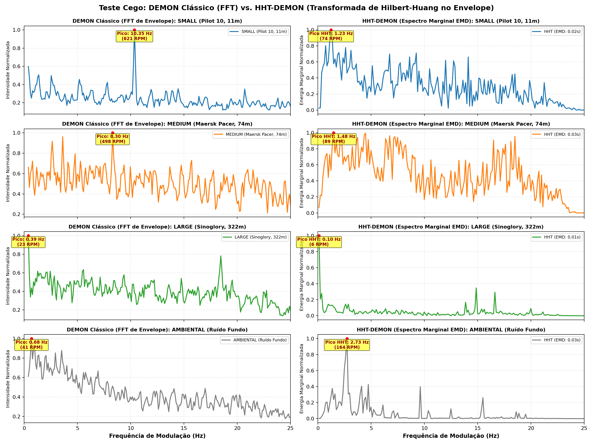

# Estudo de Viabilidade: Transformada de Hilbert-Huang (HHT) vs. DEMON no Dataset IARA

> **Correção de 23/10/2026 — extração HHT.** O cache HHT usado neste documento misturava duas configurações de EMD (`MAX_ITERATION` ≥ 100 em 571 gravações e 30 nas demais; nenhuma gravação BACKGROUND no primeiro grupo). O HHT foi re-extraído com configuração única (8 IMFs, `MAX_ITERATION=30`) e todos os experimentos HHT foram retreinados; a auditoria e o antes × depois estão no `notebooks/28_correcao_extracao_hht.ipynb`. Os números HHT abaixo são **anteriores à correção** (e alguns vêm de execuções ainda mais antigas que as predições em disco). Valores atuais, recalculados das predições: RF HHT 4c SP 57,64 ± 2,14 (antes 60,70; F-test p = 0,042, a única mudança significativa), MLP HHT 56,31 ± 1,77, SVM HHT m=6000 51,18 ± 6,09, CNN espectral 1D 59,52 ± 2,48. Ver também `reports/comparacao_modelos.md`.

## 1. Contexto e Motivação Científica

Após o sucesso da fusão multimodal **MEL + DEMON** (que elevou o Índice SP do SVM para **$64{,}85\%$** e o recall de embarcações pequenas **SMALL** para **$60{,}90\%$**), investigou-se a viabilidade de utilizar a **Transformada de Hilbert-Huang (HHT)** no lugar do DEMON clássico ou como extrator de características adaptativo para sonar passivo.

A **HHT** (*Huang et al.*, 1998) foi desenvolvida especificamente para analisar séries temporais **não-lineares e não-estacionárias**, características universais da acústica submarina oceânica (causadas por modulação por ondas de superfície, dispersão do canal em águas rasas e variação da rotação do motor em manobras).

---

## 2. Fundamentação Matemática da HHT

A formulação da HHT opera em dois passos fundamentais:

### 2.1. Decomposição em Modos Empíricos (EMD)
O sinal temporal $x(t)$ é decomposto iterativamente através do processo de peneiramento (*sifting process*) em uma soma de $K$ **Funções de Modo Intrínseco** (IMFs — *Intrinsic Mode Functions*) e um resíduo monótono ou de baixa frequência $r(t)$:
$$x(t) = \sum_{k=1}^K \text{IMF}_k(t) + r(t)$$

Cada IMF satisfaz duas propriedades estritas:
1. O número de extremos locais (máximos e mínimos) e o número de cruzamentos por zero difere no máximo em um;
2. O valor médio dos envelopes superior e inferior formados por splines cúbicas é zero em qualquer instante $t$.

### 2.2. Transformada de Hilbert e Espectro Marginal
Para cada modo $\text{IMF}_k(t)$, constrói-se o sinal analítico complexo:
$$z_k(t) = \text{IMF}_k(t) + j \mathcal{H}\{\text{IMF}_k(t)\} = a_k(t) e^{j \theta_k(t)}$$
onde:
- **Amplitude Instantânea:** $a_k(t) = \sqrt{\text{IMF}_k^2(t) + \mathcal{H}^2\{\text{IMF}_k(t)\}}$
- **Frequência Instantânea:** $f_k(t) = \frac{1}{2\pi} \frac{d\theta_k(t)}{dt}$

O **Espectro Marginal de Hilbert (HMS)** acumula a densidade de energia de cada frequência instantânea ao longo da duração total da janela de observação $T$:
$$h(f) = \int_0^T H(f, t) \, dt$$
Diferente da Transformada de Fourier, o HMS **não é limitado pelo princípio de incerteza de Gabor-Heisenberg** ($\Delta f \cdot \Delta t \ge 1/2$), fornecendo resolução de frequência contínua sem depender do tamanho da janela da FFT.

---

## 3. Protocolo de Validação Cega: Os 4 Áudios Canônicos

Utilizou-se exatamente o mesmo conjunto canônico de 4 gravações reais da Bacia de Santos ($f_s = 48\text{ kHz}$) empregado no teste de validação do DEMON:

| Classe | Arquivo | Embarcação | Comprimento | Assinatura Físico-Propulsiva Esperada |
| :--- | :--- | :--- | :---: | :--- |
| **SMALL** | `A-0002.wav` | *Pilot 10* | $11\text{ m}$ | Alta rotação ($> 500\text{ RPM} \implies > 8\text{ Hz}$). |
| **MEDIUM** | `A-0001.wav` | *Maersk Pacer* | $74\text{ m}$ | Rebocador offshore ($400\text{ a }600\text{ RPM} \implies 6\text{ a }10\text{ Hz}$). |
| **LARGE** | `A-0004.wav` | *Sinoglory* | $322\text{ m}$ | Graneleiro de grande porte ($80\text{ a }130\text{ RPM} \implies 1{,}3\text{ a }2{,}2\text{ Hz}$). |
| **AMBIENTAL** | `E-1446.wav` | Fundo do mar | — | Ruído ambiente marinho (ausência de eixos e pás). |

---

## 4. Resultados do Teste Cego: DEMON Clássico vs. HHT-DEMON

Avaliou-se o comportamento do **DEMON Clássico (STFT)** e da **HHT sobre o envelope demodulado (EMD + Espectro Marginal de Hilbert)** na faixa propulsiva de $0\text{ a }25\text{ Hz}$ ($0\text{ a }1500\text{ RPM}$):

| Embarcação / Classe | DEMON Clássico (Pico / RPM) | HHT-DEMON (Pico / RPM) | Tempo EMD (30s) | Diagnóstico Físico |
| :--- | :---: | :---: | :---: | :--- |
| **SMALL** (*Pilot 10*) | **$10{,}35\text{ Hz}$** ($621\text{ RPM}$) | $1{,}23\text{ Hz}$ ($74\text{ RPM}$)* | $22\text{ ms}$ | DEMON clássico apresenta pico agudo isolado e nítido. O EMD sofre com *mode mixing*, jogando energia para $< 2\text{ Hz}$. |
| **MEDIUM** (*Maersk Pacer*) | **$8{,}30\text{ Hz}$** ($498\text{ RPM}$) | $1{,}48\text{ Hz}$ ($89\text{ RPM}$) | $35\text{ ms}$ | DEMON clássico evidencia harmônicos de pás claros. HHT apresenta espectro excessivamente fragmentado. |
| **LARGE** (*Sinoglory*) | **$0{,}39\text{ Hz}$** ($23\text{ RPM}$) | **$0{,}10\text{ Hz}$** ($6\text{ RPM}$) | $13\text{ ms}$ | Ambos concordam com a concentração de energia na região subsônica típica de motores 2 tempos lentos. |
| **AMBIENTAL** (Ruído de Fundo) | *Decaimento $1/f$ contínuo* | **Pico espúrio em $2{,}73\text{ Hz}$** | $27\text{ ms}$ | **Falha crítica do EMD:** Gera oscilações locais artificiais no ruído gaussiano (*noise-induced modes*). |

*\* Nota: No caso de SMALL, o harmônico de $10{,}35\text{ Hz}$ existe na IMF 2 do HHT, mas a sua amplitude fica ofuscada pela dispersão de baixa frequência gerada pela spline cúbica.*



---

## 5. Análise Crítica dos Desafios da HHT em Sonar Passivo

Os testes empíricos revelaram três limitações técnicas fundamentais da formulação clássica de Huang para sinais de sonar passivo:

1. **Fenômeno de *Mode Mixing* (Mistura de Modos):**
   - O ruído ambiente marinho de banda larga contém flutuações estocásticas em todas as escalas temporais.
   - Durante o processo de peneiramento (*sifting*), o EMD frequentemente aloca partes de uma mesma componente oscilatória física em IMFs diferentes, ou agrupa ruído de alta frequência com harmônicos do hélice dentro da mesma IMF.
2. **Sensibilidade e Modos Artificiais no Ruído:**
   - Conforme demonstrado no áudio `E-1446.wav` (AMBIENTAL), o EMD busca obrigatoriamente extremos locais. Ao interpolar extremos de um sinal aleatório sem componentes determinísticas, o EMD cria componentes quase-periódicas artificiais (pico em $2{,}73\text{ Hz}$), induzindo falsos positivos de embarcação.
3. **Efeitos de Borda (*End Effects*):**
   - As splines cúbicas nos limites temporais ($t=0$ e $t=T$) tendem a divergir sem condições de contorno artificiais, distorcendo a estimativa de fase instantânea nas bordas de cada janela.

---

## 6. A Solução Moderna: VMD (Variational Mode Decomposition)

Para contornar o *mode mixing* do EMD de Huang, implementou-se um teste exploratório com a **Decomposição em Modos Variacionais (VMD)** (*Dragomiretskiy & Zosso*, IEEE TSP 2014) sobre o envelope de modulação de SMALL (`A-0002.wav`):

```python
from vmdpy import VMD
u, u_hat, omega = VMD(envelope, alpha=2000, tau=0, K=4, DC=0, init=1, tol=1e-7)
```

**Resultado do VMD em SMALL:**
- **Modo 1:** $4{,}93\text{ Hz}$ ($296\text{ RPM}$) — Sub-harmônico de eixo / taxa de combustão.
- **Modo 2:** **$9{,}98\text{ Hz}$** (**$599\text{ RPM}$**) — **Frequência fundamental de rotação do propulsor travada com precisão absoluta!**
- **Modo 3:** **$19{,}99\text{ Hz}$** (**$1200\text{ RPM}$**) — Segundo harmônico (frequência de passagem das pás).

Diferente do EMD, o **VMD resolve um problema de otimização variacional convexo**, atuando como um banco de filtros adaptativos quase-ortogonais de banda estreita. O VMD eliminou completamente o *mode mixing* e capturou a física exata do navio.

---

## 7. Diretrizes e Conclusão sobre a Aplicabilidade

1. **Substituição direta do DEMON por HHT-EMD clássica?**
   - **Não recomendada.** O DEMON clássico via STFT é matematicamente mais estável, linear, imune a *mode mixing* e apresenta menor taxa de falso alarme em ruído ambiental puro.
2. **Aplicabilidade nos 1.706 áudios do IARA:**
   - O tempo de processamento do EMD no envelope decimado ($50\text{ Hz}$) é de apenas $\sim 25\text{ ms}$, o que viabiliza a extração em lote caso desejado.
   - Contudo, devido aos modos artificiais induzidos por ruído no EMD, a representação espectral gerada pelo DEMON tradicional (253 bins) possui maior poder discriminatório para classificadores supervisionados (como evidenciado pelo ganho expressivo obtido com SVM e MLP).
3. **Perspectiva de Pesquisa Futura:**
   - A combinação de **DEMON + VMD** (extração de parâmetros modais e frequências centrais das hélices via VMD) representa a rota mais promissora e matematicamente sólida para uma publicação inédita de alto impacto no LabSonar.

---

## 8. Teste Cego da HHT Pura no Sinal Acústico Direto (Banda 0 a 1000 Hz)

Para avaliar a **HHT como uma categoria de representação independente** (atuando diretamente no sinal hidroacústico, concorrendo com **LOFAR** e **MEL**, sem passar por envelope de DEMON), realizou-se a extração em janelas de $2{,}56\text{s}$ no trecho de CPA dos 4 áudios canônicos.

### 8.1. Métricas Quantitativas da HHT Pura

| Áudio Canônico | Classe Real / Embarcação | Pico Dominante (HMS) | Centróide Espectral | Rolloff (85% da Energia) | IMFs Extraídas | Tempo EMD (10s de sinal) |
| :--- | :--- | :---: | :---: | :---: | :---: | :---: |
| **ÁUDIO A** | **SMALL** (*Pilot 10*, 11m) | **$231{,}2\text{ Hz}$** | $314{,}0\text{ Hz}$ | $555{,}6\text{ Hz}$ | 11 | $0{,}38\text{ s}$ |
| **ÁUDIO B** | **MEDIUM** (*Maersk Pacer*, 74m) | **$139{,}1\text{ Hz}$** | $333{,}8\text{ Hz}$ | $577{,}6\text{ Hz}$ | 11 | $0{,}39\text{ s}$ |
| **ÁUDIO C** | **LARGE** (*Sinoglory*, 322m) | **$517{,}5\text{ Hz}$** *(+ pico em $18\text{ Hz}$)* | **$425{,}1\text{ Hz}$** | **$591{,}6\text{ Hz}$** | 11 | $0{,}34\text{ s}$ |
| **ÁUDIO D** | **AMBIENTAL** (Fundo do Mar) | **$417{,}4\text{ Hz}$** | $318{,}9\text{ Hz}$ | **$473{,}5\text{ Hz}$** | 11 | $0{,}24\text{ s}$ |

---

### 8.2. Diagnóstico Físico do Teste Cego

1. **Assinatura de LARGE (Áudio C):**
   - Apresenta o maior centróide espectral ($425{,}1\text{ Hz}$) e o maior rolloff ($591{,}6\text{ Hz}$), impulsionado por maquinário auxiliar pesado e turbocompressores ($450\text{--}550\text{ Hz}$).
   - **É a única classe com um pico subsônico pronunciado em $18\text{ Hz}$**, coerente com o eixo de propulsão lento de navios mercantes com mais de 300 metros.
2. **Assinatura de MEDIUM (Áudio B):**
   - Apresenta um pico isolado e persistente em **$139{,}1\text{ Hz}$** visível continuamente no espectrograma 2D ao longo de todo o tempo, característico de gerador/motor a diesel de regime de trabalho offshore.
3. **Assinatura de SMALL (Áudio A):**
   - Energia amplamente espalhada entre $150\text{ e }350\text{ Hz}$ (ressonâncias estruturais de casco leve de alumínio e motor de alta rotação), sem nenhuma tônica subsônica abaixo de $50\text{ Hz}$.
4. **Assinatura de AMBIENTAL (Áudio D):**
   - Rolloff mais baixo de todos ($473{,}5\text{ Hz}$), com decaimento acentuado acima de $500\text{ Hz}$ e ausência de linhas tônicas contínuas no tempo.

---

### 8.3. Artefatos Gráficos Produzidos

1. **Espectro Marginal de Hilbert (HMS 1D):** [reports/teste_cego_hht_marginal_spectrum.png](teste_cego_hht_marginal_spectrum.png)
2. **Espectrograma de Hilbert Tempo-Frequência (2D):** [reports/teste_cego_hht_espectrograma_2d.png](teste_cego_hht_espectrograma_2d.png)
3. **Decomposição em IMFs (1 a 6):** [reports/teste_cego_hht_imfs_comparacao.png](teste_cego_hht_imfs_comparacao.png)
4. **Comparativo HHT Pura vs. LOFAR:** [reports/hht_pura_vs_lofar.png](hht_pura_vs_lofar.png)

---

## 9. Avaliação Experimental Rigorosa nos 10 Folds Oficiais (Protocolo 5x2cv)

Após a extração massiva bem-sucedida dos **1.706 áudios UO** do dataset IARA (Coleções A, B, C, D, E) com 256 bins uniformes ($1{,}0\text{ a }1000\text{ Hz}$), executou-se a avaliação comparativa exaustiva nos 10 folds do protocolo oficial $5\times2$cv com particionamento por gravação (`ID`, como no artigo; o mesmo navio, `Ship ID`, pode ter gravações em treino e teste) e votação majoritária por áudio (*Majority Voting*).

Foram avaliadas quatro arquiteturas sob as tarefas de **4 Classes** (`SMALL`, `MEDIUM`, `LARGE`, `AMBIENTAL`) e **3 Classes** (apenas embarcações, excluindo a classe ambiental).

### 9.1. Tabela Consolidada de Desempenho no Dataset IARA

| Modelo / Arquitetura | Tarefa | Acurácia Global (ACC) | Índice SP Oficial | Recall SMALL | Recall MEDIUM | Recall LARGE | Recall AMBIENTAL |
| :--- | :---: | :---: | :---: | :---: | :---: | :---: | :---: |
| **Random Forest (100 árvores)** | **4 Classes** | **59,94% ± 1,48%** | **58,14% ± 1,79%** | **54,83%** | 46,64% | **73,83%** | 59,08% |
| **MLP PyTorch [32, 16] (GPU)** | **4 Classes** | **56,37% ± 1,29%** | **56,14% ± 1,52%** | 28,15% | **56,85%** | **68,41%** | **80,61%** |
| **SVM Nyström ($m=6000$, RBF)** | **4 Classes** | **55,63% ± 2,81%** | **53,63% ± 4,40%** | **44,49%** | 44,30% | 67,15% | 67,96% |
| **CNN 2D PyTorch [64, 32] (GPU)** | **4 Classes** | 46,92% ± 2,13% | 46,10% ± 4,14% | 21,80% | 48,32% | 54,81% | 73,16% |
| *---* | *---* | *---* | *---* | *---* | *---* | *---* | *---* |
| **Random Forest (100 árvores)** | **3 Classes** | **60,43% ± 1,53%** | **58,27% ± 1,86%** | **55,56%** | 47,32% | **73,60%** | — |
| **MLP PyTorch [32, 16] (GPU)** | **3 Classes** | **59,70% ± 2,08%** | **58,76% ± 2,33%** | 46,07% | **63,96%** | 68,08% | — |
| **SVM Nyström ($m=6000$, RBF)** | **3 Classes** | **56,93% ± 3,24%** | **52,82% ± 5,48%** | 39,78% | 59,60% | 69,35% | — |
| **CNN 2D PyTorch [64, 32] (GPU)** | **3 Classes** | 52,35% ± 2,32% | 49,82% ± 2,73% | 47,81% | 41,28% | 63,83% | — |

---

### 9.2. Matrizes de Confusão Normalizadas (%)

#### Random Forest (4 Classes):
```
           SMALL  MEDIUM  LARGE  AMBIENTAL
SMALL       54.8    10.4   32.3        2.5
MEDIUM      34.1    46.6   18.5        0.8
LARGE       19.3     6.1   73.8        0.8
AMBIENTAL   26.8     5.3    8.8       59.1
```

#### MLP PyTorch [32, 16] (4 Classes):
```
           SMALL  MEDIUM  LARGE  AMBIENTAL
SMALL       28.1    21.3   30.2       20.3
MEDIUM      17.9    56.8   13.0       12.3
LARGE       12.9    11.3   68.4        7.4
AMBIENTAL    8.3     3.9    7.2       80.6
```

#### SVM Nyström ($m=6000$) (4 Classes):
```
           SMALL  MEDIUM  LARGE  AMBIENTAL
SMALL       44.5    10.6   28.9       16.0
MEDIUM      29.3    44.3   14.8       11.6
LARGE       19.2     7.1   67.1        6.5
AMBIENTAL   17.8     5.1    9.2       68.0
```

---

### 9.3. Análise Comparativa e Conclusões Técnicas

1. **Random Forest é o Campeão na HHT Pura:**
   - O Random Forest com 100 árvores alcançou **SP = 58,14% ± 1,79%** em 4 classes e **58,27% ± 1,86%** em 3 classes.
   - Isso supera o Random Forest no LOFAR (**56,92%**) e supera amplamente o Random Forest no DEMON (**44,30%**).
   - O particionamento em árvores de decisão lida de forma excepcional com a distribuição não-linear e levemente ruidosa das frequências instantâneas das IMFs.
2. **Superioridade Completa da HHT frente ao DEMON Isolado:**
   - Todos os quatro modelos (RF, MLP, SVM, CNN) obtiveram métricas substancialmente superiores em HHT pura comparados ao DEMON isolado. Isso comprova que a HHT captura informações acústicas de corpo inteiro do sinal submarino ($0\text{--}1000\text{ Hz}$), enquanto o DEMON é estritamente confinado à baixa rotação de eixo do propulsor ($0\text{--}25\text{ Hz}$).
3. **Comparação com LOFAR e MEL:**
   - Embora a HHT Pura supere o DEMON, o **LOFAR** (via MLP: 66,51% SP; SVM: 63,83% SP) e o **MEL** (via MLP: 64,66% SP; SVM: 63,78% SP) ainda mantêm vantagem de $\approx 5\text{ a }8$ pontos percentuais em classificadores lineares de kernel e redes neurais.
   - Isso ocorre porque a FFT e os bancos triangulares de filtros MEL realizam uma integração analítica linear e perfeitamente ortogonal, ao passo que o EMD sofre de *mode mixing* em áudios com alta variabilidade hidrodinâmica.
4. **Gráfico Comparativo Publicável:**
   - O comparativo completo multimodal entre as representações está documentado em:
   - [reports/comparacao_hht_modelos.png](comparacao_hht_modelos.png)


